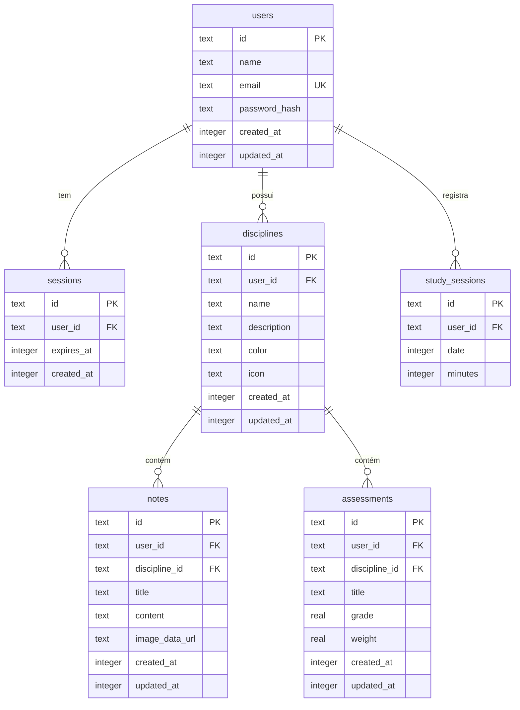

# IndividuAula

Aplicação full stack do Projeto Integrador II da AEDB, criada para apoiar a rotina de estudos dos alunos do Colégio Estadual Marechal Souza Dantas, em Resende. O aluno organiza disciplinas, anotações e avaliações, acompanha médias e ritmo de estudo e encontra conteúdos de apoio.

Em produção: [app.individuaula.workers.dev](https://app.individuaula.workers.dev)

## funcionalidades

- cadastro, login, logout e edição de perfil, com sessão no servidor;
- disciplinas com cor e ícone, anotações com editor e imagem de apoio, avaliações com média ponderada;
- dashboard com média geral, disciplinas ativas e ritmo de estudos da semana;
- pesquisa de conteúdos educacionais (YouTube Data API, feita no servidor) com rolagem infinita: mais vídeos carregam sozinhos conforme o aluno desce a lista;
- tema claro e escuro, layout responsivo e identidade visual do colégio.

## tecnologias

| camada | tecnologia |
| --- | --- |
| aplicação | Next.js 16 (App Router), React 19 e TypeScript |
| interface | Tailwind CSS 4, shadcn/ui (base-ui) e lucide-react |
| validação | Zod |
| banco de dados | Cloudflare D1 (SQLite) com Drizzle ORM |
| hospedagem | Cloudflare Workers, via OpenNext |
| testes | Vitest, Testing Library e Playwright |

## arquitetura

```text
navegador (React)
   ↓  fetch, com cookie de sessão HttpOnly
rotas de API do Next.js   ← validação com Zod, checagem de origem, limite de tentativas
   ↓
serviços                  ← autenticação e dados acadêmicos; toda consulta filtra pelo dono
   ↓
Drizzle ORM
   ↓
Cloudflare D1
```

| responsabilidade | onde fica |
| --- | --- |
| telas e componentes | `app/`, `components/` |
| estado do cliente (sessão em memória, atualização imediata, fila de gravação) | `components/app-provider.tsx`, `lib/api-client.ts`, `lib/study-state.ts` |
| rotas de API | `app/api/**`, `server/api.ts`, `server/rate-limit.ts` |
| autenticação e senhas | `server/auth-service.ts`, `server/crypto.ts`, `lib/session.ts` |
| dados acadêmicos | `server/study-data.ts`, `server/demo-data.ts` |
| busca de vídeos e rolagem infinita | `server/youtube-search.ts`, `hooks/use-video-search.ts`, `components/study/content-search.tsx` |
| validação de entrada | `lib/validators.ts` |
| banco de dados | `db/schema.ts`, `drizzle/`, `server/db.ts` |
| testes | `tests/` (veja `docs/TEST_PLAN.md`) |

Rotas de API: `POST /api/auth/register|login|logout`, `GET /api/auth/session`, `GET|PATCH /api/auth/profile`, `GET /api/data`, `POST /api/demo-data`, `POST /api/disciplines`, `PATCH|DELETE /api/disciplines/[id]` (o mesmo para `notes` e `assessments`) e `GET /api/youtube/search`.

## banco de dados

Todos os dados do sistema ficam no **Cloudflare D1** (SQLite gerenciado), acessado pelo **Drizzle ORM**. O navegador não guarda nada: sem `localStorage`, tudo vive no banco.

### modelo de dados



`PK` é a chave primária, `FK` a chave estrangeira e `UK` um valor único. As datas são guardadas em milissegundos.

| tabela | o que guarda |
| --- | --- |
| `users` | contas dos alunos: nome, e-mail único e hash da senha |
| `sessions` | logins abertos (um por aparelho), com validade de 7 dias |
| `disciplines` | matérias do aluno, com cor e ícone |
| `notes` | anotações de uma disciplina (texto formatado e imagem opcional) |
| `assessments` | provas e trabalhos, com nota e peso para a média ponderada |
| `study_sessions` | minutos estudados por dia, que alimentam o gráfico semanal |

### decisões do modelo

- **isolamento por aluno:** toda tabela acadêmica tem `user_id` do dono, e toda consulta filtra por ele. Um aluno nunca enxerga os dados de outro;
- **exclusão em cascata:** as chaves estrangeiras usam `ON DELETE CASCADE`. Excluir uma disciplina apaga suas anotações e avaliações, e excluir uma conta apaga tudo dela, sem deixar registros órfãos;
- **segredos só como hash:** a senha é guardada com PBKDF2 e sal individual, e a sessão guarda o hash do token. Um vazamento do banco não revela senhas nem permite assumir sessões;
- **índices por aluno:** cada tabela tem um índice em `user_id` (e em `discipline_id` quando existe), porque é assim que as telas consultam.

### onde está no código

| arquivo | função |
| --- | --- |
| [`db/schema.ts`](db/schema.ts) | **definição das tabelas** em TypeScript, a fonte da verdade do modelo |
| [`drizzle/`](drizzle) | migrações SQL geradas a partir do schema, versionadas no git |
| [`drizzle.config.ts`](drizzle.config.ts) | configuração do Drizzle Kit |
| [`server/db.ts`](server/db.ts) | liga o banco D1 (binding `DB`) ao Drizzle |
| [`server/auth-service.ts`](server/auth-service.ts) | contas, login e sessões |
| [`server/study-data.ts`](server/study-data.ts) | consultas e gravações de disciplinas, anotações e avaliações |
| [`wrangler.jsonc`](wrangler.jsonc) | declara o banco `individuaula-db` e o binding `DB` |

Um trecho do `db/schema.ts`, com a tabela de disciplinas:

```ts
export const disciplines = sqliteTable(
  "disciplines",
  {
    id: text("id").primaryKey(),
    userId: text("user_id").notNull().references(() => users.id, { onDelete: "cascade" }),
    name: text("name").notNull(),
    description: text("description").notNull().default(""),
    color: text("color").notNull(),
    icon: text("icon").notNull().default("book"),
    createdAt: timestamp("created_at").notNull(),
    updatedAt: timestamp("updated_at").notNull(),
  },
  (table) => [index("disciplines_user_idx").on(table.userId)],
);
```

### migrações

| arquivo | o que faz |
| --- | --- |
| `drizzle/0000_blushing_matthew_murdock.sql` | cria as tabelas e os índices iniciais |
| `drizzle/0001_remove_fluxo_de_email.sql` | remove a tabela e a coluna do fluxo de e-mail, retirado até haver domínio |

Para alterar o banco:

```bash
# 1. edite db/schema.ts
pnpm db:generate          # gera a migração SQL em drizzle/
pnpm db:migrate:local     # aplica no banco local (.wrangler/state, fora do git)
pnpm db:migrate:remote    # aplica no D1 de produção
```

### como mostrar o banco funcionando

No painel da Cloudflare: **Storage & databases → D1 → individuaula-db**. A aba **Tables** lista as tabelas e permite ver os registros.

Ou pelo terminal, direto no banco de produção:

```bash
# lista as tabelas (d1_migrations é a tabela de controle das migrações, criada pelo wrangler)
pnpm exec wrangler d1 execute DB --remote --command "SELECT name FROM sqlite_master WHERE type='table' AND name NOT LIKE '_cf_%' ORDER BY name"

# mostra as contas sem expor a senha (só o início do hash)
pnpm exec wrangler d1 execute DB --remote --command "SELECT name, email, substr(password_hash, 1, 16) AS hash FROM users"

# conta os registros de cada aluno
pnpm exec wrangler d1 execute DB --remote --command "SELECT u.email, (SELECT count(*) FROM disciplines d WHERE d.user_id = u.id) AS disciplinas FROM users u"
```

### evolução planejada

- **confirmação de e-mail e recuperação de senha:** o fluxo chegou a ser implementado e testado, mas foi retirado até existir um domínio próprio para o envio de e-mails (Resend);
- **login com Google**, como alternativa ao cadastro por senha;
- **limite de tentativas global:** hoje cada instância do Worker conta as suas; o plano é usar as regras de Rate Limiting da Cloudflare;
- **imagens das anotações no R2:** hoje vão no D1, que limita cada linha a 2 MB (por isso o limite de 700 KB por imagem);
- **troca de e-mail da conta**, que depende da confirmação de e-mail.

## como executar

```bash
pnpm install
pnpm db:migrate:local   # cria o banco local e aplica as migrações
pnpm dev
```

Abra [http://localhost:3000](http://localhost:3000). Para a busca real no YouTube, copie `.dev.vars.example` para `.dev.vars` e preencha `YOUTUBE_API_KEY`; sem a chave a busca devolve resultados de exemplo.

## testes

```bash
pnpm typecheck     # tipos
pnpm lint          # estilo e erros comuns
pnpm test          # unitários e integração (rotas e serviços contra um D1 real em memória)
pnpm test:coverage # cobertura
pnpm test:e2e      # fluxos completos no navegador (Chromium e iPhone)
```

O plano de testes, com a rastreabilidade dos requisitos, está em `docs/TEST_PLAN.md`.

## publicação na Cloudflare

```bash
pnpm exec wrangler login   # uma vez
pnpm db:migrate:remote     # aplica migrações novas no D1 de produção
pnpm run deploy            # build do OpenNext e publicação (use "run": `pnpm deploy` é um comando nativo do pnpm)
pnpm preview               # roda o build de produção localmente
pnpm exec wrangler secret put YOUTUBE_API_KEY   # ativa a busca real no YouTube
```

## segurança

- senhas com PBKDF2-SHA256 e sal individual, comparadas em tempo constante; o login de um e-mail inexistente gasta o mesmo tempo de um existente;
- sessões guardadas só como hash; cookie `HttpOnly`, `SameSite=Lax` e `Secure` em HTTPS;
- toda consulta filtra pelo dono do registro, e registros alheios respondem 404;
- limite de tentativas em login, cadastro e busca; checagem de origem contra CSRF; erros sem detalhes internos;
- cabeçalhos de segurança (CSP, `X-Frame-Options`, `nosniff`, `Referrer-Policy`, `Permissions-Policy`, HSTS) em `lib/security-headers.ts`;
- anotações higienizadas no navegador e no servidor; imagens restritas a PNG, JPG, WEBP e GIF.

## limitações conhecidas

- não há recuperação de senha por e-mail até existir um domínio para o envio;
- o e-mail da conta ainda não pode ser alterado;
- o limite de tentativas vive na memória de cada instância do Worker; a proteção global fica a cargo de uma regra de Rate Limiting da Cloudflare.
